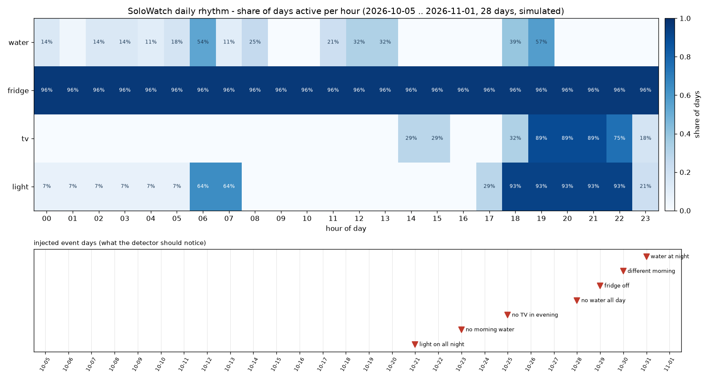
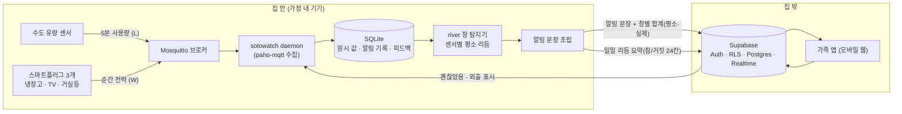
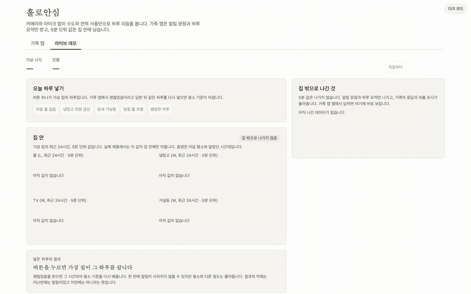
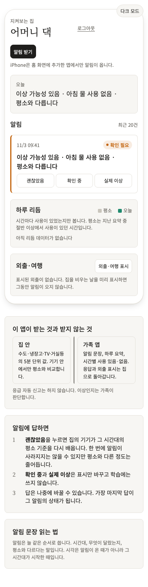
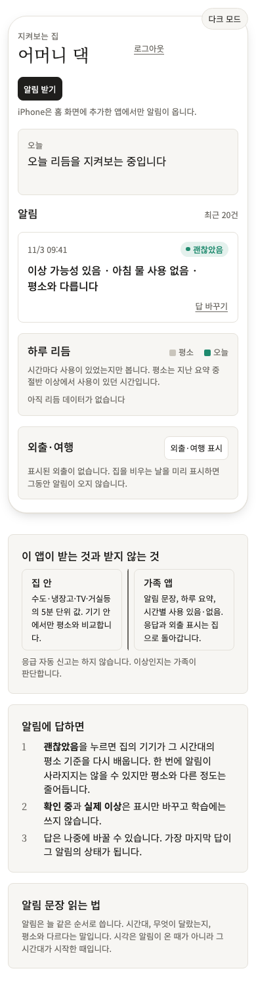
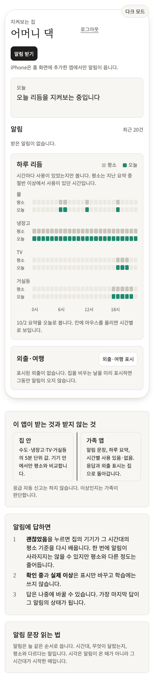
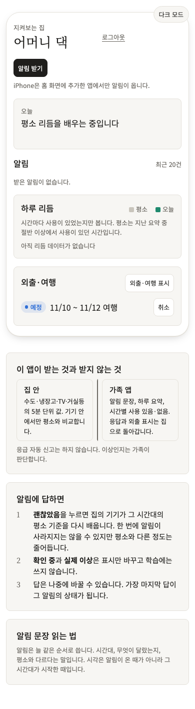
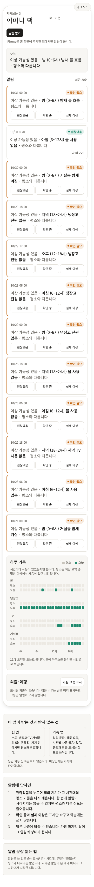

# 홀로안심 (SoloWatch)

## 철학
지켜보는 것과 감시하는 것은 다르다. 카메라 없이, 이미 흐르는 데이터만으로 이상을 알아챈다.

## 문제
- 혼자 사는 노인의 이상 징후를 며칠 뒤에야 가족이 안다
- 카메라·웨어러블은 당사자가 거부하거나 충전을 잊는다
- 안부 전화는 받는 쪽도 거는 쪽도 부담이다

## 방향
- 스마트미터·수도 사용량 또는 스마트플러그 몇 개만으로 생활 리듬을 학습
- 평소와 다른 패턴(아침에 물을 안 씀, 밤새 전등이 안 꺼짐)에 가족에게 조용한 알림
- 알림은 "이상 가능성 있음" 수준으로, 과잉 경보를 피한다
- 당사자에게도 "오늘 리듬 정상" 한 줄, 감시가 아닌 동행의 느낌으로

## 하지 않는 것
- 응급 자동 신고 (가족이 판단)
- 영상·음성 수집

## 한눈에
- **입력**: 스마트플러그 3개(냉장고·TV·거실등) + 수도 유량 센서 1개. 카메라·마이크·웨어러블 없음.
- **처리**: 집 안 작은 기기(라즈베리파이) 한 대가 MQTT 로 값을 받아 SQLite 에 쌓고, 센서마다 6시간 창 단위로 평소 리듬을 배운다. 처음 2주는 학습만 한다.
- **출력**: 평소와 다른 창이 있으면 가족 앱에 `이상 가능성 있음 · 아침 (6~12시) 물 사용 없음 · 평소와 다릅니다` 한 줄. 저녁 8시에는 `오늘 리듬 정상 · …` 한 줄.
- **집 밖으로 나가는 것**: 알림 문장, 창별 합계 두 숫자(평소·실제)와 이유, 하루 한 번의 리듬 요약(센서별 "그 시간에 쓰였나" 참/거짓 24칸과 첫 사용 시각)뿐이다. 원시 측정값·시간별 값·영상·음성은 집 밖에 없고, 원시 계량값은 집 안 SQLite 에만 남는다.
- **가족의 판단이 돌아온다**: 앱에서 "괜찮았음"을 누르면 기기가 그 창을 평소로 다시 배운다. 외출 기간을 표시하면 그동안은 알림도 학습도 쉰다.

모의 가정 28일(학습 14일 + 관찰 14일, 이벤트 7개)의 생활 리듬:



> 칸의 진하기 = 그 시간에 센서가 쓰인 날의 비율. 아래 줄은 모의로 넣은 이상 일(밤새 거실등, 아침 물 없음, 저녁 TV 없음, 종일 물 없음, 냉장고 전원 끊김, 다른 아침, 밤중 물 흐름). 그림은 영문 라벨(water / fridge / tv / light)로 그린다.

## 아키텍처
경계를 넘는 화살표는 세 개뿐이다. 자세한 설명과 데몬 tick 흐름은 [docs/architecture.md](docs/architecture.md).



카메라·마이크·원시 센서 데이터는 집 밖 어디에도 없다. 가족은 Supabase RLS 로 자기 가구의 알림만 읽고, 가정 기기는 `device` 역할로 알림·요약만 쓸 수 있다.

## 라이브 데모
라즈베리파이·센서 없이 브라우저 하나로 본다: **https://solowatch-demo-912282052399.asia-northeast3.run.app/demo**



- 한 페이지에 탭 두 개다. 처음 열면 **라이브 데모** 탭이다. 이벤트 버튼 5개, "집 안"(클라우드 가상 집의 센서 4개, 최근 24시간 5분 값 d3 그래프. 실제 제품에서는 집 안에만 머무는 값), 넣은 하루의 결과(점수 전후 표), 집 밖으로 나간 것(알림 문장·창별 합계·일일 요약, 돌아온 피드백)이 보인다. **가족 앱** 탭은 데모 계정으로 로그인한 진짜 가족 앱이 같은 페이지 안에 그대로 열린다. `/demo#family`, `/demo#demo` 로 탭을 바로 열 수 있다.
- 버튼 한 번이 가상의 하루다. "아침 물 없음"을 누르면 가상 집이 그 하루를 수 초 안에 살고, 집 안 그래프가 3초 동안 다시 그려지며 평소와 달랐던 시간대에 음영이 생긴다. 가족 앱 탭으로 가면 알림 한 줄이 와 있다. 거기서 "괜찮았음"을 누르고 라이브 데모 탭으로 돌아와 같은 이벤트를 다시 넣으면 그 시간대의 점수 전후(지난번·이번)가 보인다. 점수는 내려가지만, 한 번의 피드백으로 알림이 바로 억제된다는 보장은 없다. 두 번째에도 알림이면 화면에 `알림`, 억제되면 `억제`로 그대로 표시한다.
- 오른쪽 위 버튼으로 라이트·다크 모드를 바꾼다. 처음에는 기기 설정을 따른다.
- 가족 앱만 보려면 공개 URL 의 `/login` 에서 **데모로 둘러보기**를 누른다 (데모 계정으로 바로 들어간다). 휴대폰에서는 홈 화면에 추가(PWA)하고 "알림 받기"로 웹 푸시를 켤 수 있다.
- 데모 가구는 방문자 모두가 함께 쓰는 1개다. 다른 사람이 누른 이벤트도 같이 보인다. 가상 14일이 지나면 처음 상태로 자동 초기화되고, 초기화 때 알림·피드백·요약을 비운다.
- 무료 등급이라 오래 쉬면 첫 접속에 "가상 집을 준비하는 중입니다" 또는 "데모가 잠들어 있습니다"가 보일 수 있다. 잠시 뒤 다시 열면 된다.

로컬에서 같은 화면 (아래 "실행 방법 2)"의 1~3단계 뒤):
```bash
set -a && . ./.env && set +a && uv run solowatch demo-server --port 8845   # 터미널 1: 가상 집 + /api/demo
(cd web && npm run dev)                                                    # 터미널 2: http://localhost:8840/demo
```
GIF 는 `bash scripts/make_demo_gif.sh` 로 다시 만든다 (Playwright 녹화 → ffmpeg).

## 실행 방법
### 1) 하드웨어·계정 없이 30초: 스모크
```bash
uv sync
uv run solowatch smoke --db data/raw/solowatch.sqlite --out data/raw/smoke.json
```
모의 수도 센서 28일치를 만들어 SQLite 에 넣고 창 탐지기에 흘린 뒤 한 줄을 출력한다.
```
SMOKE detected 3/3 injected days, false positive days 0/11
```

### 2) 로컬 풀 데모: 모의 센서 4개 → MQTT → 데몬 → Supabase → 가족 앱
전제: Docker(로컬 Supabase), [Supabase CLI](https://supabase.com/docs/guides/local-development), `brew install mosquitto`, Node.js. 외부 계정·API 키는 필요 없다.

| 단계 | 명령 | 결과 |
|---|---|---|
| 1. 설치 | `uv sync --group viz && (cd web && npm ci)` | Python·웹 의존성 |
| 2. 로컬 Supabase | `supabase start` | API `localhost:57321`, Studio `localhost:57323`. 스키마·RLS·데모 계정 시드 |
| 3. 키 연결 | `cp .env.example .env` 후 `supabase status -o env` 의 `ANON_KEY` 를 `.env` 의 `SUPABASE_ANON_KEY` 와 `web/.env.local` 의 `VITE_SUPABASE_ANON_KEY` 에 넣는다 (`VITE_SUPABASE_URL=http://localhost:57321`) | 키는 커밋하지 않는다 |
| 4. 브로커 | `mosquitto -c deploy/mosquitto-dev.conf` (Homebrew 는 `/opt/homebrew/sbin/mosquitto`) | `localhost:57883`, 개발용 익명 |
| 5. 데몬 먼저 (터미널 A) | `cp config/solowatch.example.toml config/solowatch.toml && set -a && . ./.env && set +a && uv run solowatch daemon --config config/solowatch.toml --once --idle-seconds 15 --now 2026-11-02T00:00:00+09:00` | 브로커를 구독하고 기다린다. 15초 동안 새 메시지가 없으면 한 번 처리하고 끝난다 |
| 6. 모의 센서 28일 발행 (터미널 B, 5단계 4초쯤 뒤) | `set -a && . ./.env && set +a && uv run solowatch publish-mock --config config/solowatch.toml` | `PUBLISHED 32256 messages for 4 sensors`. 터미널 A 의 데몬이 `data/raw/home.sqlite` 에 32,256 값을 쌓고 이상 알림을 Supabase 로 보낸다 |
| 7. 가족 앱 | `(cd web && npm run dev -- --port 8840 --strictPort)` → `http://localhost:8840` | `family@example.com` / `solowatch-demo-1234` 로 로그인, 알림에 "괜찮았음" → 5단계 데몬을 `--now 2026-11-02T00:10:00+09:00` 으로 다시 돌리면(발행 없이) 데몬이 피드백을 학습에 반영 |

- 순서가 중요하다. 브로커는 구독 전 메시지를 남기지 않으므로(clean session) 발행을 먼저 하면 데몬은 값 0개로 끝난다. 빈 상태로 데몬을 한 번 돌렸다면 처리 커서가 앞서 나가 있으니 `data/raw/home.sqlite` 를 지우고 5단계부터 다시 한다.
- 외출 시드 주의: 외출 기간(10-26·27)을 먼저 넣지 않으면 그 이틀도 알림이 나가 16건 안팎이 된다. 가족 앱 외출 표시로 10-26~10-27 을 넣고 돌리면 그 이틀은 0건, 나머지 7건 이상이다.

상시 실행은 `--once` 없이 `uv run solowatch daemon --config config/solowatch.toml` (기본 60초 tick, 매일 20시 일일 요약).

리듬 그림은 데몬이 쌓은 저장소에서 다시 그린다:
```bash
uv run solowatch render-rhythm --db data/raw/home.sqlite --out docs/figures/rhythm-28d.png --scenario default
```

### 3) 테스트
```bash
uv run pytest tests/unit -q                                  # 단위
uv run ruff check src tests && uv run mypy src               # 린트·타입
supabase test db                                             # RLS (pgTAP)
uv run pytest tests/e2e -q                                   # MQTT→데몬→Supabase 체인 (Mosquitto 를 테스트가 띄움)
(cd web && npx playwright test --project=app)                # 가족 앱 (390px 모바일 화면)
```

로컬 포트: Supabase 57320~57329, Mosquitto 57883, 가족 앱 개발 8840 · Playwright preview 8841 · E2E Apprise 수신기 8842.

## 가족 앱
모바일 웹(Vite + React, 디자인 토큰 CSS, 폰트 Noto Sans KR 셀프호스팅). 로그인 → 오늘 카드 → 최근 알림 → 하루 리듬 → 외출 표시. 넓은 화면(860px 이상)에서는 오른쪽에 안내 카드 3장(이 앱이 받는 것과 받지 않는 것, 알림에 답하면, 알림 문장 읽는 법)이 붙는다. 화면은 Playwright E2E 가 390px 폭으로 찍은 것이다.

| 오늘 | 알림과 "괜찮았음" | 오늘의 리듬 |
|---|---|---|
|  |  |  |

| 외출·여행 표시 | 데몬까지 돌아간 피드백 |
|---|---|
|  |  |

- 알림은 빨간색도 사이렌도 아닌 한 줄이다. 가족은 `괜찮았음` · `확인 중` · `실제 이상` 중 하나를 누른다. 답한 뒤에도 `답 바꾸기`로 다시 고를 수 있고, 가장 마지막 답이 그 알림의 상태가 된다.
- 하루 리듬은 센서마다 24칸 두 줄(평소·오늘)이다. 칸을 누르거나 마우스를 올리면 그 시간의 사용 여부가 아래 한 줄로 보이고, 평소 쓰던 시간에 오늘 사용이 없으면 "평소 쓰던 N시간에 사용 없음"이 붙는다.
- 외출은 시작한 기간이면 `표시 중`·`오늘 종료`, 아직 시작하지 않았으면 `예정`·`취소`다. 날짜를 빠뜨리거나 거꾸로 넣으면 저장 전에 폼 아래에 바로 알려 준다.
- 실패 안내는 팝업 대신 해당 카드 안의 한 줄로 보인다. 오른쪽 위 버튼으로 다크 모드를 켤 수 있다.
- 앱은 알림을 대신 신고하지 않는다. 전화를 걸지, 이웃에게 부탁할지는 가족이 판단한다.

## 운영 기록
목표는 "가정 1곳 4주(학습 2주 + 알림 2주)" 동안 가족이 체감한 오경보·놓친 경보를 기록하는 것이다. 실가정 운영 전이므로 지금 저장소에는 **모의 28일 재생 결과**가 들어 있다.

- 샘플: [docs/ops-sample.md](docs/ops-sample.md) — `날짜 | 알림 | 가족 판단 | 분류` 표와 `합계 | 알림 N건 | | 오경보 n건 · 놓친 경보 m건`.
- 생성: `bash scripts/make_ops_sample.sh` (모의 가정 → 탐지 → 모의 피드백 → `solowatch ops-report --scenario default`).
- 실운영에서는 같은 `ops-report` 를 기기의 SQLite 에 돌린다: `uv run solowatch ops-report --db data/raw/home.sqlite --out ops.md`.

## 라즈베리파이 설치
설치자가 따라 하는 순서는 [docs/runbook-pi.md](docs/runbook-pi.md) 에 있다: 하드웨어 목록, Pi OS Lite 64-bit, `deploy/install.sh`(멱등), 플러그(Tasmota·Zigbee2MQTT·Home Assistant)를 Pi 브로커에 연결하는 설정 매핑, `journalctl -u solowatch` 로 확인, 4주 운영 절차.

- 데몬은 `deploy/solowatch.service` (systemd, `Restart=on-failure`) 로 상주한다.
- 브로커는 `deploy/mosquitto.conf` (Pi 안에서만 듣고 비밀번호 파일 사용).
- 모든 Python 의존성의 aarch64 휠 해석을 확인했다 (`uv pip compile --python-platform aarch64-manylinux_2_28`).

## 기술 선택
후보 비교(라이선스·크기·Pi 적합성·유지보수)와 선택 이유는 [docs/decisions.md](docs/decisions.md).

| 영역 | 선택 | 한 줄 이유 |
|---|---|---|
| 이상 탐지 | river (BSD-3) | 센서·창별 온라인 통계, 학습·점수를 한 줄씩. 통계 코드를 직접 쓰지 않는다 |
| 브로커 / 클라이언트 | Mosquitto / paho-mqtt | 스마트홈 생태계가 모두 이 브로커 기준으로 문서화돼 있다 |
| 저장 | SQLite (표준 라이브러리) | Pi 한 대, 서버 없음 |
| 인증·권한·실시간 | Supabase (Apache-2.0) | Auth·RLS·Realtime 을 직접 만들지 않는다 |
| 알림 미러 | Apprise (BSD-2, 선택) | URL 한 줄로 메신저 100여 종 |
| 가족 앱 | Vite + React + CSS 토큰 + d3 | 라이트·다크를 CSS 변수 한 벌로. 집 안 선그래프만 d3, 리듬 격자는 CSS |
| 그림 | matplotlib · Mermaid | 리듬 히트맵 · GitHub 가 바로 그리는 아키텍처 |

## 데모
공개 URL 로 하는 라이브 30초 진행표와 로컬 3분 데모 진행표는 [docs/demo-script.md](docs/demo-script.md).

## 한계와 다음
- 실제 센서·실가정 4주 운영은 아직이다. 지금은 모의 가정과 설치 산출물(런북·systemd·브로커 설정)까지다.
- 냉장고 플러그는 5분 평균 전력이라 문 여닫음은 보이지 않는다. "전원이 끊겼다"는 생존 신호로만 쓴다.
- 아침 창이 정오에 닫히므로 "아침 물 사용 없음"은 정오에 알 수 있다.
