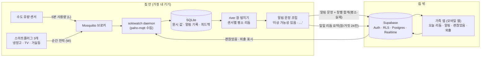
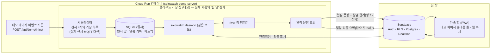
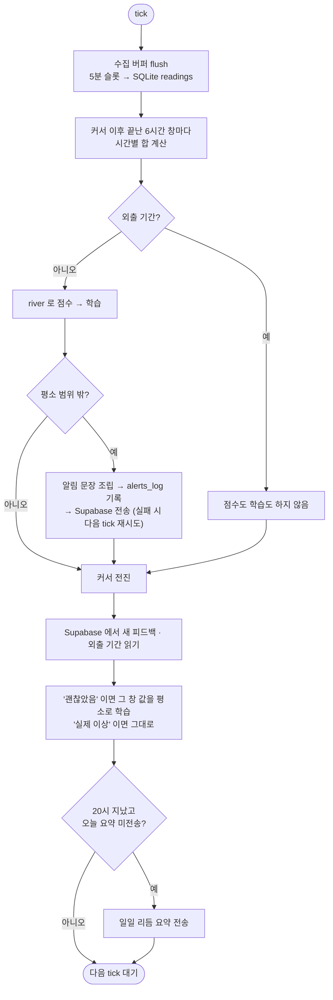

# 아키텍처

> 한 줄: 센서 값은 집 안 작은 기기에서 처리한다. 집 밖으로 나가는 것은 알림 문장, 창별 합계 두 숫자(평소·실제), 하루 리듬 요약(시간대별 사용 여부 24칸)뿐이다. 원시 측정값·시간별 값·영상·음성은 집 밖에 없다.

**카메라·마이크·원시 센서 데이터(5분 값, 시간별 합, SQLite 파일)는 집 밖 어디에도 없다.**

## 1. 데이터 경계

점선 상자 경계를 넘는 화살표는 세 개뿐이다. 그 밖의 화살표는 모두 한쪽 상자 안에서 끝난다.

| 경계를 넘는 것 | 방향 | 내용 |
|---|---|---|
| 알림 문장 + 창별 합계 | 집 → 밖 | `이상 가능성 있음 · 아침 (6~12시) 물 사용 없음 · 평소와 다릅니다` 와 창 시각, 센서별 이유와 그 6시간 창의 합계 두 숫자(평소·실제). 5분 값·시간별 값은 없다 |
| 일일 리듬 요약 | 집 → 밖 | 하루 한 줄 문장 + 센서마다 "그 시간에 쓰였나" 참/거짓 24칸 + 첫 활동 시각. 사용량 수치는 없다 |
| 괜찮았음 · 외출 표시 | 밖 → 집 | 가족이 누른 판단(`괜찮았음`·`확인 중`·`실제 이상`)과 외출 기간. 데몬이 주기적으로 읽어 간다 |

선택 사항으로, 같은 알림 문장을 Apprise 로 가족 메신저에 한 번 더 보낼 수 있다 (`SOLOWATCH_APPRISE_URLS`). 이때 메신저로 나가는 건 같은 문장 하나뿐이고, 합계 숫자는 보내지 않는다.

권한은 Supabase RLS 가 맡는다. 가정 기기는 `device` 역할로 알림·요약만 쓸 수 있고, 가족은 `family` 역할로 자기 가구 행만 읽고 피드백·외출만 쓸 수 있다. 다른 가구 행은 보이지 않는다 (pgTAP 테스트로 검증).

## 1.1 클라우드 가상 집 (라이브 데모)

공개 데모에는 실제 집이 없다. 그래서 "집 안" 상자 전체를 Cloud Run 컨테이너 하나 안으로 옮기고, 센서 입력만 시뮬레이터로 바꿨다. 데몬·SQLite·river 탐지기·알림 문장 조립은 실제 제품과 같은 코드다 (MQTT 브로커만 빠지고 시뮬레이터가 저장소에 바로 쓴다). 경계를 넘는 화살표는 그대로 세 개다.

- 데모 페이지 왼쪽 "집 안" 패널의 그래프(`/api/demo/state` 의 최근 값)는 이 컨테이너 안 값을 시연용으로 보여 주는 것이다. 실제 제품에서는 집 밖으로 나가지 않는 값이고, Supabase 로 가는 행에는 들어가지 않는다.
- 가운데 "집 밖으로 나간 것" 패널은 위 세 화살표로 실제로 오간 행만 보여 준다.
- 공유 가구 1개를 모든 방문자가 같이 쓴다. 버튼 한 번이 가상 하루이고, 가상 14일 뒤 자동 초기화한다.

## 2. 데몬 tick (기본 60초마다)

- 처음 14일은 학습 기간이라 알림을 보내지 않는다.
- 하루는 6시간 창 4개(밤 0~6, 아침 6~12, 오후 12~18, 저녁 18~24)로 나눠 본다. 그래서 "아침 물 사용 없음"은 정오에 판단된다.
- 브로커에 연결하지 못하면 데몬은 종료 코드 3으로 끝나고 systemd 가 다시 띄운다.

## 3. 구성 요소와 라이선스

| 구성 요소 | 역할 | 라이선스 |
|---|---|---|
| Mosquitto | 집 안 MQTT 브로커 | EPL-2.0 / EDL-1.0 |
| paho-mqtt | 데몬의 MQTT 클라이언트 | EPL-2.0 / EDL-1.0 |
| SQLite (표준 라이브러리) | 원시 값·알림 기록 저장 | Public domain |
| river | 센서·창별 평소 리듬 통계 | BSD-3 |
| supabase-py | 기기 로그인 + 알림 행 쓰기 | MIT |
| Apprise (선택) | 같은 문장을 메신저로 미러 | BSD-2 |
| Supabase | 인증·RLS·DB·실시간 | Apache-2.0 |
| Vite + React + Mantine + @mantine/charts | 가족 앱 | MIT |
| systemd | 라즈베리파이에서 데몬 상주 | OS 기본 |

비교와 선택 이유는 [decisions.md](decisions.md).
