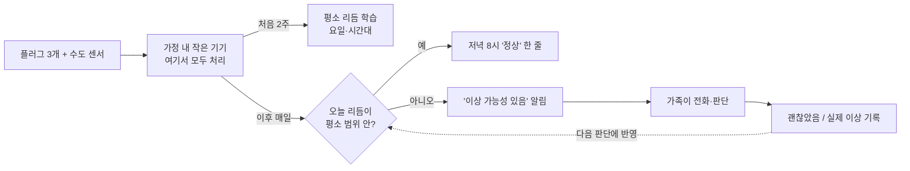
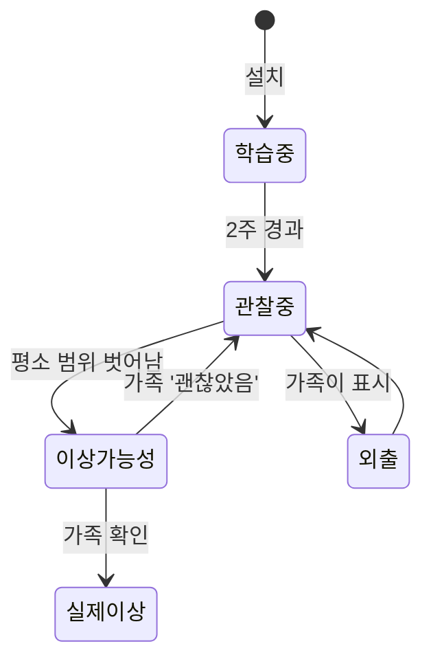

# 홀로안심 (SoloWatch) — 완성된 모습

> 이 문서는 "어떻게 만들까"가 아니라 "다 만들어졌을 때 사용자가 무엇을 보고 겪는가"를 적는다.
> 내부 구조는 나중에 docs/system-overview.md 와 docs/decisions.md 에서 다룬다.

## 한 문장

카메라 없이 스마트플러그 세 개와 수도 센서 하나로 어르신의 생활 리듬을 배우고, 평소와 다른 아침이면 가족에게 "이상 가능성 있음" 한 줄을 조용히 보낸다.

## 등장인물

| 역할 | 상황 | 바라는 것 |
|---|---|---|
| 혼자 사는 어르신 (80세) | 카메라는 싫다, 손목시계 충전은 잊는다 | 감시당하는 느낌 없이 지내고 싶다 |
| 멀리 사는 자녀 | 주 1회 전화, 매번 "별일 없지?"가 전부 | 별일 있을 때만 알고 싶다, 매일 걱정하긴 싫다 |
| 설치자 (운영자) | 첫 가정 1곳 설치 | 2주 학습 후 알림이 쓸 만한지 4주 기록 |

## 시나리오 1: 설치하는 날

1. 냉장고, TV, 거실등 플러그에 스마트플러그를 끼우고, 싱크대 아래 수도관에 유량 센서를 붙인다. 작은 상자 하나(가정 내 기기)를 콘센트에 꽂는다. 30분.
2. 어르신에게는 "별일 있으면 따님한테 알려주는 거예요. 카메라도 마이크도 없어요"라고 설명한다. 어르신 폰에는 아무것도 깔지 않는다.
3. 자녀 폰에 가족 앱. 첫 화면: "2주 동안 어머니의 평소 리듬을 배우는 중입니다. 알림은 11월 5일부터 시작됩니다."

## 시나리오 2: 평범한 날

1. 자녀 폰에 매일 저녁 8시 한 줄: **"오늘 리듬 정상 · 아침 6시 40분 물 사용, 저녁 TV 켬"**. 열어 보지 않아도 된다.
2. 어르신 집 거실에는 작은 표시등 또는 어르신 폰이 있다면 한 줄: "오늘도 평소처럼 지내셨네요." 감시가 아니라 동행의 톤.

## 시나리오 3: 다른 아침

1. 평소 6시 반이면 물을 쓰고 7시면 냉장고가 열리는데, 오전 10시까지 수도도 냉장고도 조용하다. 거실등은 밤새 켜져 있다.
2. 자녀 폰에 알림 한 줄: **"이상 가능성 있음 · 오전 10시까지 물·냉장고 사용 없음, 거실등 밤새 켜짐 · 평소와 다릅니다"**. 빨간색도 사이렌도 아니다.
3. 자녀가 전화한다. 어르신이 받는다. "어제 친구 집에서 자고 왔다." 자녀가 앱에서 "괜찮았음"을 누른다. 이 피드백이 오경보 기록이 된다.
4. 받지 않으면 자녀가 판단해 이웃이나 119에 연락한다. 앱이 대신 신고하지 않는다.

## 시나리오 4: 외출·여행

- 자녀가 "이번 주 어머니 여행"을 앱에 표시하면 그 기간엔 알림을 쉬고 학습에도 쓰지 않는다.

## 화면 스케치

가족 앱 홈:

```
┌─────────────────────────────┐
│ 홀로안심 · 어머니 댁           │
│                             │
│  ● 오늘 리듬 정상             │
│    아침 6:40 물 사용          │
│    7:05 냉장고 · 21:30 TV     │
│                             │
│  오늘의 리듬                  │
│  0   3   6   9   12  15  18  21  24│
│  물  ·   ·   ▌   ·   ▌   ·   ▌   · │
│  냉  ·   ·   ▌▌  ▌   ▌   ·   ▌▌  · │
│  TV  ·   ·   ·   ·   ·   ·   ███  ·│
│  등  █   ·   ·   ·   ·   ·   ███  █│
│  ─ 회색: 평소 범위             │
│                             │
│  최근 알림                    │
│  10/18 이상 가능성 → 괜찮았음  │
│                             │
│  [외출·여행 표시]  [설정]      │
└─────────────────────────────┘
```

이상 알림(푸시):

```
┌─────────────────────────────┐
│ 홀로안심                      │
│ 이상 가능성 있음 · 10:00       │
│ 오전 10시까지 물·냉장고 사용 없음│
│ 거실등 밤새 켜짐               │
│ 평소: 6~7시 사이 물 사용        │
│ [전화 걸기]  [괜찮았음]  [확인 중]│
└─────────────────────────────┘
```

어르신 쪽(선택, 폰이 있다면):

```
┌─────────────────────────────┐
│  오늘도 평소처럼 지내셨네요 🙂  │
│  따님에게 "정상" 전해졌어요     │
└─────────────────────────────┘
```

## 흐름도





## MVP가 끝났을 때 손에 쥐는 것

- 가정 1곳 설치: 플러그 3개(냉장고·TV·거실등) + 수도 유량 센서 1개 + 가정 내 처리 기기.
- 가족 앱(모바일 웹): 오늘 리듬, 알림, 괜찮았음 버튼, 외출 표시.
- 4주 운영 기록(학습 2주 + 알림 2주).

| 날짜 | 알림 | 가족 판단 | 분류 |
|---|---|---|---|
| 11/08 | 이상 가능성 | 친구 집 숙박 | 오경보 |
| 11/14 | 없음 | 감기로 종일 누움 (가족이 전화로 앎) | 놓친 경보 |
| ... | | | |
| 합계 | 알림 N건 | | 오경보 n건 · 놓친 경보 m건 |

- 하루 리듬 그림(위 ASCII를 실제 데이터로).

## "됐다"고 말할 수 있는 순간

- 어르신이 4주 동안 기기를 떼지 않는다(거부감 없음).
- 자녀가 "알림이 와서 전화했더니 실제로 평소와 달랐다"를 한 번이라도 경험하거나, 반대로 오경보가 하루 1건을 넘지 않는다.
- 영상·음성은 어디에도 없고, 집 밖으로 나가는 데이터는 알림 문장뿐이라는 걸 그림 한 장으로 설명할 수 있다.

## 이번엔 안 만드는 것

응급 자동 신고, 영상·음성 수집, 웨어러블, 다가구. (README "하지 않는 것" 참조)
